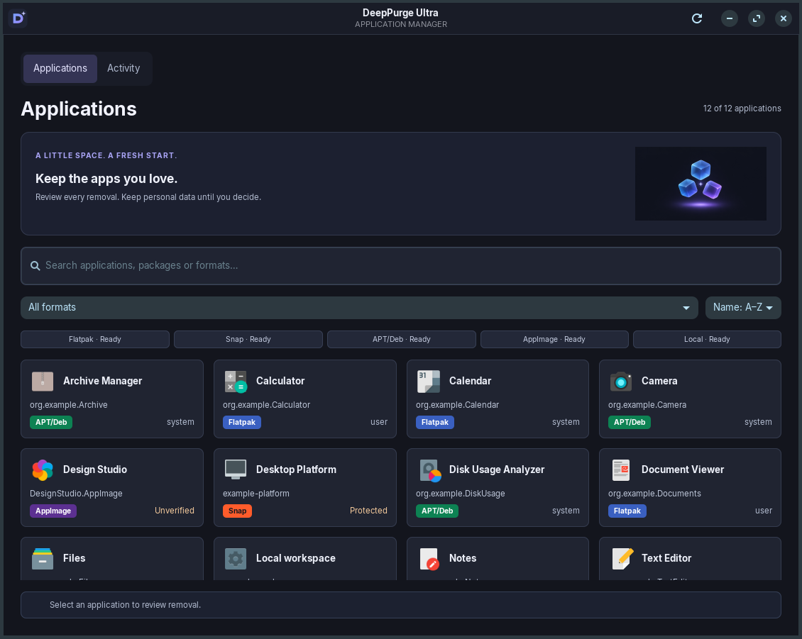

# DeepPurge Ultra

A native GTK3 application manager for Ubuntu and Zorin desktops. Discover apps,
review exactly which installation will be removed, uninstall through the native
backend, and separately review verified leftover data. The interface stays in
your normal user session; privileged package operations use native authentication.

[GitHub repository](https://github.com/rtariq2015/DeepPurge-Ultra)



Screenshots use explicitly identified layout fixtures rather than publishing the
user's installed-app inventory. They are real GTK window captures, not mockups.

## Features

- Dark charcoal surfaces, violet accents, an original app mark and optional artwork.
- A fluid `Gtk.FlowBox` inside `Gtk.ScrolledWindow`, with independent cards that
  have a 240 × 110 minimum size, 8px corners, hover lighting and keyboard focus.
- Real application icons with a fallback, bold names, package identifiers, source
  scopes and format badges. Relative font sizing lets cards grow with larger text.
- Search, format filters, alphabetical sorting, refresh and accurate filtered counts.
- Background discovery, a bounded worker pool, batched GTK updates and backend status.
- Visible Retry/Details notices for failed sources, explicit partial-scan counts,
  and Protected, Unverified or Shortcut captions on entries with limited actions.
- Native uninstall previews, serialized operations, real status updates, backend
  verification and persistent Activity history.
- Separate, unchecked-by-default cleanup of verified locations using recoverable Trash.

## Badge colors

| Format | Badge background |
| --- | --- |
| Flatpak | `#3a60c1` |
| Snap | `#ff5c2b` |
| AppImage | `#5c3091` |
| APT/Deb | `#0d8253` |
| Custom/Local | `#c42944` |

## Installation

Use Python **3.10 or newer** and your distribution's PyGObject bindings:

```bash
sudo apt update
sudo apt install python3 python3-gi python3-gi-cairo gir1.2-gtk-3.0
```

For APT/Deb removal through PackageKit:

```bash
sudo apt install packagekit gir1.2-packagekitglib-1.0
```

A working desktop PolicyKit authentication agent is needed for privileged native
transactions. Zorin and Ubuntu desktop sessions normally provide one. Flatpak
requires the `flatpak` tool; Snap uses an existing snapd daemon through its Unix
socket. Missing backends do not prevent the dashboard from opening. No pip
packages are required. This version is intended to run from its source checkout;
cross-distribution packaging is outside its scope.

## Launch

```bash
cd /home/home/DeepPurge-Ultra
python3 src/deep_purge.py
```

The verified checkout location is `/home/home/DeepPurge-Ultra`. Use
`/usr/bin/python3 src/deep_purge.py` if a virtual environment hides system GTK
bindings. Run as your regular user, without `sudo`; the GUI refuses root execution.
The entry point filters incompatible GTK loaders and schema directories inherited
from Snap-packaged editors when using the system interpreter.

A failed scan is not presented as an empty installation list. If a whole refresh
fails, previous results remain visible with removal disabled until a successful
retry. A failed source is marked **Scan failed**; missing optional tools remain
**Unavailable**. Corrupt Activity records do not block application inventory or
replace a verified backend result. Other persistence failures are reported separately.

Keyboard shortcuts: **Ctrl+F** focuses search, **Ctrl+R** refreshes inventory,
**Escape** clears a focused search, and **Tab/Shift+Tab** navigate controls.
Activate focused cards with the native button keyboard controls.

## Desktop launcher

The supplied launcher uses these requested values:

```ini
Exec=/usr/bin/python3 /home/home/DeepPurge-Ultra/src/deep_purge.py
Icon=system-software-install
```

Install it into your application menu:

```bash
mkdir -p ~/.local/share/applications
install -m 644 assets/deep-purge-ultra.desktop ~/.local/share/applications/
```

If the checkout moves, update both `Exec` and `Path` in the launcher. The custom
DeepPurge mark appears inside the application; the menu keeps the requested
system icon.

## Supported actions and their limits

| Backend | Implemented action | Important limits |
| --- | --- | --- |
| Flatpak | Uninstall an exact installation, app ID, architecture and branch using Flatpak | Data is retained. Related refs and unused runtimes are retained. System scope can require authentication. |
| APT/Deb | PackageKit asynchronous ordinary removal after a native simulation | Not Debian purge. Configuration files remain. Transactions affecting other packages are refused; autoremove is disabled. Essential, protected, desktop-core and driver packages are blocked. |
| Snap | snapd REST removal with native authorization and tracked change status | Default removal normally saves a snapshot; optional purge suppresses the new snapshot only. Existing snapshots remain. Shared graphics/theme/desktop platforms are blocked. |
| AppImage | Move a verified, exact executable and listed user integration to Trash | Direct executables in the user's home only. ELF/AppImage magic, ownership, path and package ownership are checked without running the image. Wrappers, linked parents and external/system integration are unsupported. |
| Custom/Local | Move a verified, non-package-managed user shortcut to Trash | This removes a shortcut, not its application or executable. Unverified system entries have no enabled removal action. |

Desktop metadata enriches package-backed identities. Discovery respects XDG
application directories and desktop-file precedence, including hidden overrides;
it never executes launcher commands. Debian apps are mapped to installed owning
packages. Distinct Flatpak installations and refs remain separate cards. AppImage
inspection is bounded to launchers, not a scan of the entire home or filesystem.

Package managers remove their own packaged launchers and binaries. Authentication
cancellation, locks, dependency changes and partial failures produce an actual
result rather than a success animation. The UI offers no unsafe transaction
cancellation and stays open during removal. Unknown backend outcomes are marked
unverified; they are not reported as success.

## Optional leftover cleanup

Package removal and user-data cleanup are separate operations. After a verified
Flatpak or AppImage removal, choose **Review leftover data**. Every candidate is
initially unchecked and shows its exact path and association:

- Flatpak: `~/.var/app/<application-id>`, its documented sandbox data namespace.
  Cleanup is blocked if another installed ref or scope still uses that app ID.
- AppImage: the documented adjacent `<executable>.home` and
  `<executable>.config` portable directories.

Data moves to desktop Trash only after explicit selection. Paths and ownership
are checked again immediately before each move. Changed files and symlinked
parent directories are refused; a symlink target itself is moved without
traversing its destination. If Trash is unavailable, the path stays in place;
there is no permanent-delete fallback.

XDG configuration, cache, data and state locations are not searched by similar
folder names. Unmapped paths, shared vendor directories, package configuration
files and personal documents remain. No claim is made that every trace can be
removed. Snap data and snapshots follow snapd's own removal policy.

Trash and package operations are not transactional: a partial result may leave
some paths or integration behind. The result dialog and Activity record report
what could not be completed. Restore trashed files using your file manager's
Trash view; restoring application binaries does not reinstall managed packages.

## Screenshots

- [Wide application grid](docs/screenshots/applications-wide.png)
- [Narrow layout](docs/screenshots/applications-narrow.png)
- [Larger text](docs/screenshots/large-text.png)
- [Uninstall details](docs/screenshots/uninstall-details.png)
- [Empty search](docs/screenshots/empty-search.png)
- [Incomplete scan and retry notice](docs/screenshots/incomplete-scan.png)
- [Activity](docs/screenshots/activity.png)

The [artwork notes](assets/illustrations/README.md) include the original generation
prompt. Artwork is optional; missing files fall back to native symbolic icons.

## Development and verification

```bash
/usr/bin/python3 tests/run.py
/usr/bin/python3 -m compileall -q src tests
```

For headless GTK tests and desktop-file validation:

```bash
sudo apt install xvfb dbus-x11 desktop-file-utils
dbus-run-session -- xvfb-run -a env DEEPPURGE_UI_TESTS=1 GDK_BACKEND=x11 /usr/bin/python3 tests/run.py
desktop-file-validate assets/deep-purge-ultra.desktop
```

The opt-in native checks create a disposable Flatpak repository/installation in
an isolated temporary HOME and XDG directories. They install and remove only
that fixture, test real Trash moves on temporary AppImage/shortcut fixtures, and
perform a **read-only** PackageKit simulation on `baobab` when installed:

```bash
dbus-run-session -- xvfb-run -a env DEEPPURGE_NATIVE_TESTS=1 DEEPPURGE_UI_TESTS=1 GDK_BACKEND=x11 /usr/bin/python3 tests/run.py
```

Native tests require Flatpak and PackageKit to be available. They do not remove
host packages or user applications. Snap removal and interactive APT/Flatpak/Snap
authentication have not been destructively integration-tested on this desktop.
Adapter tests cover failure and cancellation reporting. See
[verification evidence](docs/verification.md) and
[implementation decisions with official references](docs/implementation.md).
The [engineering review](docs/review-2026-11-07.md) separates confirmed defects,
remaining risks and deferred improvements. Private live-inventory screenshots
are kept under ignored `artifacts/local/`; the public captures use fixture data.

Regenerate the fixture screenshots:

```bash
GDK_BACKEND=x11 xvfb-run -a -s '-screen 0 1600x1200x24' /usr/bin/python3 tests/capture_ui.py
```

GitHub Actions runs unit and GTK tests plus Python, whitespace and launcher
checks. It deliberately does not uninstall host packages.

## Source layout

```text
src/deep_purge.py          Entry point and inherited-runtime sanitation
src/deeppurge/app.py       GTK interface and background operation controller
src/deeppurge/models.py    Immutable shared records
src/deeppurge/discovery.py XDG scanning and identity reconciliation
src/deeppurge/backends.py  Flatpak, snapd, PackageKit and local-file adapters
src/deeppurge/cleanup.py   Verified cleanup rules and Trash validation
src/deeppurge/history.py   Activity, logs and operation lock
assets/                   CSS, launcher, original mark and welcome artwork
tests/                    Unit, GTK and isolated native checks
docs/                     Decisions, verification evidence and screenshots
```

Logs and the latest 200 Activity records live under
`$XDG_STATE_HOME/deep-purge-ultra`, defaulting to
`~/.local/state/deep-purge-ultra`, outside the source tree. The directory also
holds the operation lock. These files are local runtime state and are excluded
from Git. Activity writes use exclusively created temporary files and atomic
replacement. Shared, symbolic-link and non-regular state files are refused.

## Version-one boundaries

Ubuntu/Zorin desktops are the initial target. Automatic cleanup, driver removal,
arbitrary uninstall scripts, whole-filesystem scans, automatic dependency cleanup,
pip/npm environments, cloud services and distribution packaging are deferred.
This is a tested implementation with the integration limits stated above, not a
claim that every native backend and authentication path is production-certified.
